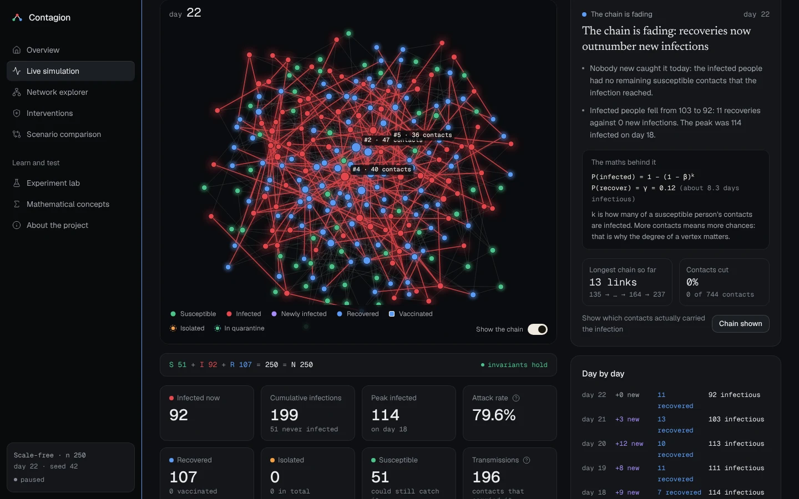
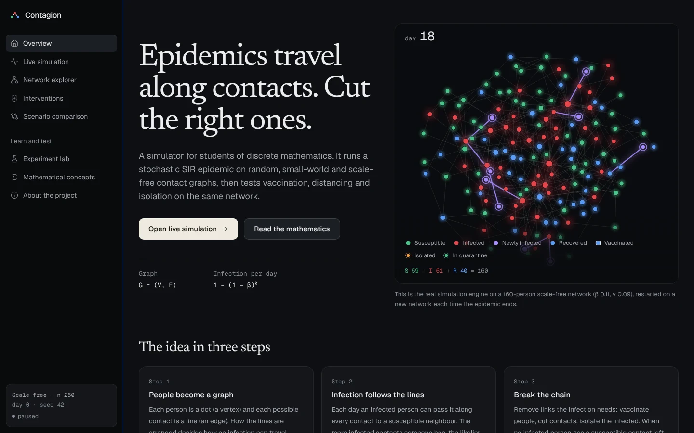
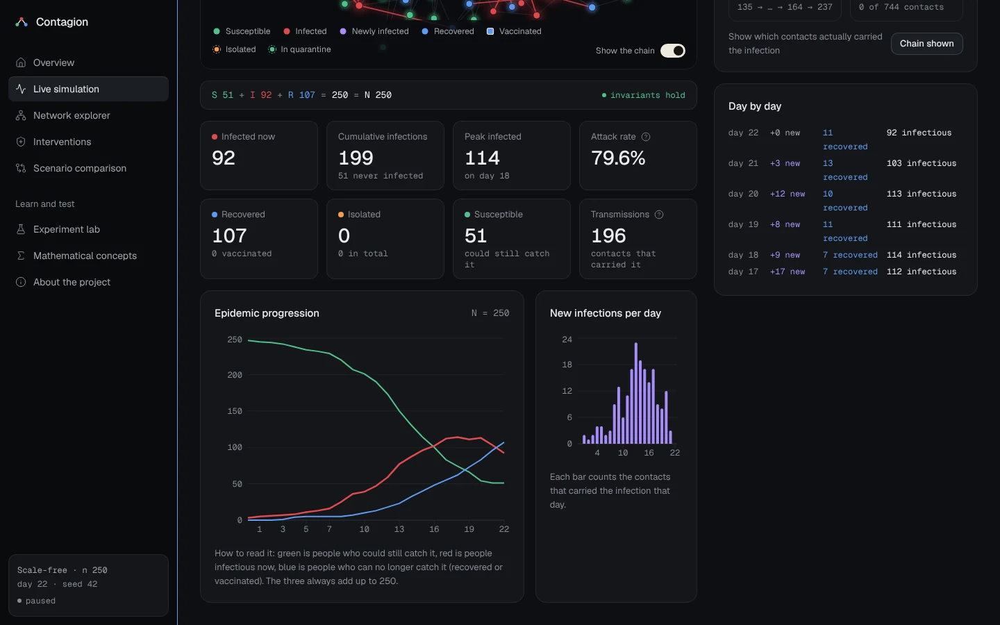
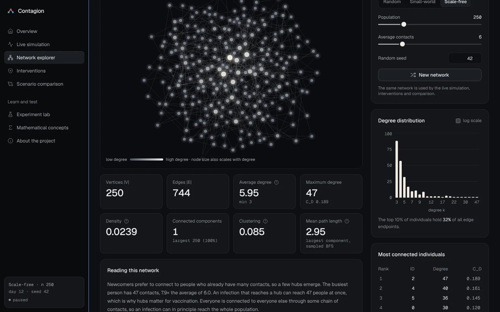
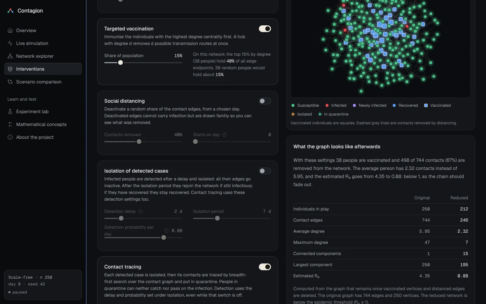
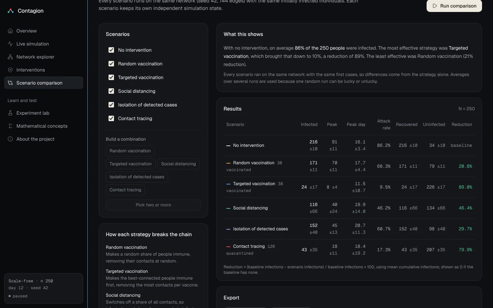
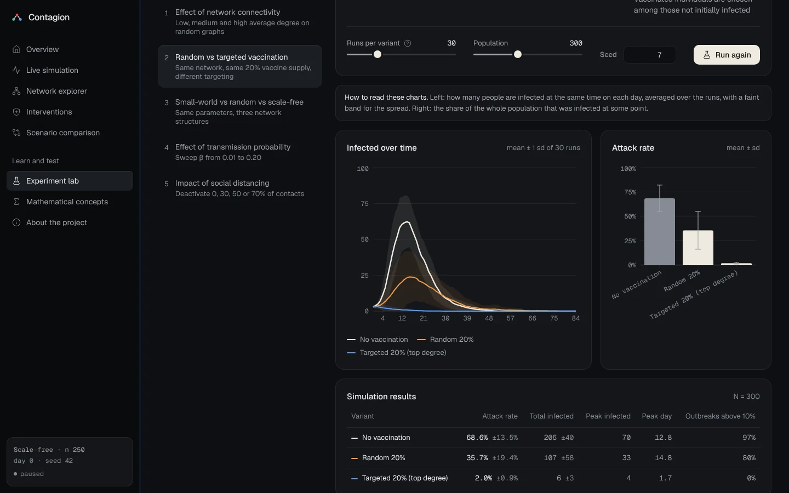
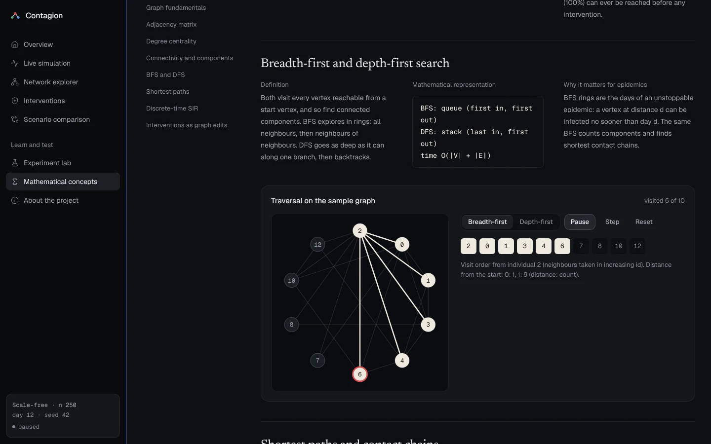
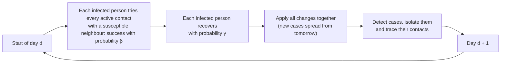

<div align="center">

# Contagion

**Watch an epidemic spread through a network of contacts, then find the links that stop it.**

An interactive simulator for a Discrete Mathematical Structures project. A stochastic SIR epidemic runs on random, small-world and scale-free contact graphs, and vaccination, social distancing, isolation and contact tracing are tested on the same network.


[Features](#features) · [Quick start](#quick-start) · [How it works](#how-it-works) · [Results](#what-the-model-shows) · [Project structure](#project-structure)

</div>



> [!NOTE]
> **Educational model.** Contagion is built for teaching graph theory. It is not a clinical or epidemiological prediction tool and must not be used for medical or public-health decisions.

Everything runs in the browser. There is no backend, no account and no API key.

## Contents

- [Features](#features)
- [Quick start](#quick-start)
- [The pages](#the-pages)
- [How it works](#how-it-works)
- [What the model shows](#what-the-model-shows)
- [Exporting results](#exporting-results)
- [Project structure](#project-structure)
- [Testing](#testing)
- [The mathematics](#the-mathematics)
- [Assumptions and limitations](#assumptions-and-limitations)
- [Tech stack](#tech-stack)

## Features

- **Live epidemic on a real graph.** Start, pause, step one day at a time and inspect any person: who infected them, when, and how many others they infected.
- **Three kinds of network.** Random (Erdős–Rényi), small-world (Watts–Strogatz) and scale-free (Barabási–Albert), each measured from the generated graph: degrees, density, components, clustering, path length.
- **Five interventions as graph operations.** Vaccination removes vertices, distancing removes edges, isolation and quarantine switch edges off, and contact tracing searches outward from each detected case with breadth-first search.
- **Fair comparisons.** Every scenario runs on the same network with the same first cases, repeated many times, and is reported as a mean with spread.
- **Explained as it happens.** A narrator describes each day in plain language and works the infection formula through with that day's real numbers.
- **The maths, interactive.** Adjacency matrices, degree centrality, BFS and DFS, shortest paths and the epidemic threshold R₀ = 1, all shown on the network you generated.
- **Export.** Daily counts, the chain of transmissions, parameters, comparison and experiment results, and the edge list as CSV, plus the network as PNG.

<table>
  <tr>
    <td width="50%"><br><b>Overview.</b> The real engine running a small epidemic, restarted on a new network each time it ends.</td>
    <td width="50%"><br><b>Live simulation.</b> Susceptible, infected and recovered over time, new infections per day, and a running check that S + I + R = N.</td>
  </tr>
  <tr>
    <td><br><b>Network explorer.</b> Generate a population and measure it. Hubs are larger and brighter.</td>
    <td><br><b>Interventions.</b> Switch strategies on and see how many contacts they cut and how the estimated R₀ changes.</td>
  </tr>
  <tr>
    <td><br><b>Scenario comparison.</b> Every strategy against the same baseline, with the reduction in infections.</td>
    <td><br><b>Experiment lab.</b> Five repeatable experiments with averages, spread and a written conclusion.</td>
  </tr>
  <tr>
    <td colspan="2"><br><b>Mathematical concepts.</b> Step through breadth-first and depth-first search on a sample of your network.</td>
  </tr>
</table>

## Quick start

You need **Node.js 22.12 or newer** (required by the test runner; the app itself builds on Node 20.19+).

```bash
git clone https://github.com/aryan5x/contagion.git
cd contagion
npm install
npm run dev
```

Then open the address Vite prints, usually <http://localhost:5173>.

| Command | What it does |
| --- | --- |
| `npm run dev` | Start the development server with hot reload |
| `npm test` | Run the engine test suite (Vitest) |
| `npm run typecheck` | Check types with TypeScript |
| `npm run build` | Build for production into `dist/` |
| `npm run preview` | Serve the production build locally |

## The pages

| Page | What you can do |
| --- | --- |
| **Overview** | See a live miniature epidemic, and a result computed when the page opens: random against targeted vaccination |
| **Live simulation** | Run the epidemic day by day, change β, γ and the network, click any person to inspect them, follow the story of each day |
| **Network explorer** | Generate random, small-world or scale-free networks and read their statistics and degree distribution |
| **Interventions** | Configure vaccination, distancing, isolation and contact tracing, and preview the reduced contact graph |
| **Scenario comparison** | Run every strategy, or your own combination, on the same network and seed, then replay them side by side |
| **Experiment lab** | Five experiments: connectivity, random vs targeted vaccination, network type, transmission probability, distancing |
| **Mathematical concepts** | Definitions, formulas and interactive demos of the graph theory behind the model |
| **About the project** | Algorithms, invariants, assumptions and limitations |

**Keyboard shortcuts** on the live page: <kbd>Space</kbd> start or pause, <kbd>N</kbd> or <kbd>→</kbd> step one day, <kbd>R</kbd> reset.

## How it works

The population is a graph **G = (V, E)**: each person is a vertex and each possible contact is an edge. Every person is in one of three states: **S**usceptible, **I**nfected or **R**ecovered (vaccinated people count as R). Time moves in whole days.



A susceptible person with *k* infected contacts therefore catches the infection with probability **1 − (1 − β)<sup>k</sup>**, which is why well-connected people matter so much.

### Interventions as graph operations

| Intervention | What it does to the graph | Settings |
| --- | --- | --- |
| Random vaccination | Removes a random sample of vertices before day 0 | Share of the population |
| Targeted vaccination | Removes the vertices with the highest degree first | Share of the population |
| Social distancing | Switches off a random share of edges from a chosen day | Share of contacts, start day |
| Isolation | Detected cases have all their edges switched off for a while | Detection delay and probability, isolation period |
| Contact tracing | From each detected case, a breadth-first search finds contacts up to *d* hops away and quarantines them | Depth, share of contacts found, tracing delay, quarantine period |

## What the model shows

On the default network (250 people, scale-free, average 6 contacts, seed 42) with the default settings, averaged over 20 runs in **Scenario comparison**:

| Strategy | People infected | Reduction vs no intervention |
| --- | ---: | ---: |
| No intervention | 86% | baseline |
| Random vaccination (15%) | 68% | 21% |
| Isolation of detected cases | 61% | 30% |
| Social distancing (40% of contacts) | 46% | 46% |
| Contact tracing (1 hop, 70% found) | 17% | 80% |
| **Targeted vaccination (15%)** | **10%** | **89%** |

The same number of vaccines works far better when it goes to the best-connected people, because a scale-free network depends on a few hubs. Your numbers will differ with other networks, seeds and settings, which is the point of the app.

## Exporting results

| Where | File | Contents |
| --- | --- | --- |
| Live simulation → Data | Daily counts (CSV) | S, I, R, new and cumulative infections, isolated and quarantined, per day |
| Live simulation → Data | Transmissions (CSV) | Who infected whom, on which day, along which edge |
| Live simulation → Data | Parameters (CSV) | Network, β, γ, seed and every intervention setting, to reproduce a run |
| Live simulation → Data | Network image (PNG) | The network as it looks now |
| Scenario comparison | Results table, daily curves (CSV) | Mean and spread of every statistic per scenario, and the average epidemic curve |
| Experiment lab | Results table, daily curves (CSV) | The same, for each experiment variant |
| Network explorer | Edge list (CSV), network image (PNG) | Every edge with both degrees, ready for Gephi or NetworkX |

Files are named after the network and seed, for example `contagion_scale-free-n250-k6-seed42_day22_daily.csv`.

## Project structure

```
src/
├── engine/                  Pure TypeScript simulation engine: no React, no DOM
│   ├── randomGenerator.ts   Seeded random numbers (mulberry32) with independent streams
│   ├── graphGenerator.ts    Erdős–Rényi, Watts–Strogatz, Barabási–Albert
│   ├── graphAnalysis.ts     Degrees, components, BFS, DFS, shortest paths, R₀ estimate
│   ├── transmissionEngine.ts  One day of transmission and recovery
│   ├── interventionEngine.ts  Vaccination, distancing, isolation, contact tracing
│   ├── epidemicModel.ts     The Simulation class: the single source of truth for a run
│   ├── metricsCalculator.ts Metrics, averages and the invariant checker
│   ├── experimentRunner.ts  Repeated runs and scenario comparison
│   ├── experiments.ts       The five experiments and their written interpretation
│   ├── narrative.ts         Data behind the day-by-day story
│   └── exporters.ts         CSV builders
├── components/              Network canvas, charts and shared interface pieces
├── pages/                   The eight pages
└── state/workspace.tsx      Shared settings, the network and the live simulation
tests/                       Engine, contact tracing, narrative and export tests
docs/screenshots/            Images used in this README
```

The interface only reads from the engine: node colours, charts, tables and written conclusions all come from `Simulation` objects and their history. Long comparisons and experiments run in small chunks so the page stays responsive.

## Testing

```bash
npm test
```

The test suite checks the model's rules directly, for example:

- `S + I + R = N` on every day, and each person is in exactly one state
- nobody is infected twice; recovered and vaccinated people are never infected
- every infection has a source that was infectious the day before and a real edge between them
- nothing passes along a distanced edge, from an isolated person, or to or from someone in quarantine
- contact tracing reaches exactly the contacts within its depth, and never changes any other random draw
- β = 0 gives no infections, and a graph with no edges gives no spread
- generated graphs are simple, and adjacency matrices are symmetric with row sums equal to degrees
- scenarios sharing a seed start from the same infected people
- CSV exports are correctly quoted and match the simulation

The live page also shows `S + I + R = N` and an "invariants hold" check, computed from the current state.

## The mathematics

<details>
<summary><b>Networks</b></summary>

- **Erdős–Rényi** `G(n, p)` with `p = ⟨k⟩/(n − 1)`: every pair of people is connected independently with probability `p`.
- **Watts–Strogatz:** a ring where each person knows their `k/2` nearest neighbours on each side; each of those edges then has its far end rewired with probability `p_rewire` (no self-loops or duplicates).
- **Barabási–Albert:** start from `m + 1` people who all know each other; each newcomer connects to `m` existing people, chosen with probability proportional to how many contacts they already have.

Measures: average degree `⟨k⟩ = 2|E|/|V|`, density `2|E| / (|V|(|V| − 1))`, degree centrality `C_D(v) = deg(v)/(|V| − 1)`.
</details>

<details>
<summary><b>One day of the SIR model</b></summary>

All decisions use the state at the start of the day.

1. Each infected, non-isolated person tries every active contact with a susceptible neighbour, succeeding with probability `β`.
2. Each infected person recovers with probability `γ`, so the mean infectious period is `1/γ` days.
3. Both sets of changes are applied together, so someone infected today first spreads it tomorrow.
4. Cases are detected (after a delay, with a daily probability) and isolated.
5. With contact tracing on, each newly detected case is traced breadth-first and the contacts found are quarantined.
</details>

<details>
<summary><b>The epidemic threshold</b></summary>

An infected person with a geometric infectious period passes the infection across one particular contact with probability

`T = β / (β + γ − βγ)`

On a configuration-model network the basic reproduction number is approximately (Newman, 2002)

`R₀ ≈ T · (⟨k²⟩ − ⟨k⟩) / ⟨k⟩`

and a large outbreak is only possible when `R₀ > 1`. Because `⟨k²⟩` appears in the formula, networks with hubs spread infection far more easily, and removing hubs (targeted vaccination) lowers `R₀` fastest. The app shows `R₀` as an estimate computed from the generated network.
</details>

<details>
<summary><b>Contact tracing</b></summary>

Every detected case is isolated, using the isolation detection settings even when isolation itself is switched off. A breadth-first search then follows active contacts up to `depth` hops from that case. Each contact is found with probability `coverage`, and only people who were found are traced further, so at two hops roughly `coverage²` of second-step contacts are reached. Susceptible and infected people found are quarantined from `delay` days after the detection, for `duration` days. In quarantine they can neither catch nor pass on the infection.
</details>

<details>
<summary><b>Comparisons and reproducibility</b></summary>

`Reduction (%) = (baseline − intervention) / baseline × 100`, reported as 0 when the baseline is 0.

The network and the first infected people depend only on the seed. Transmission, vaccination, distancing, isolation and tracing each use their own random stream derived from the seed and the run number, so scenarios that share a seed start from the same population and the same cases, and extra runs only vary the chance events.
</details>

## Assumptions and limitations

- The contact network is fixed and unweighted; real contacts change over time and differ in strength.
- Everyone infected is equally infectious. There is no incubation period, asymptomatic spread, age structure, reinfection or waning immunity.
- Vaccination is perfect and instant, applied before day 0.
- Detection, isolation and quarantine are idealised: isolated and quarantined people make no contacts at all.
- The three network generators are textbook models; real networks sit somewhere between them.
- The `R₀` estimate assumes a large, uncorrelated network, so it is rougher for small or highly clustered ones.
- Populations are capped at 1,000 in the interface so every simulation runs smoothly in the browser.

## Tech stack

| | |
| --- | --- |
| Interface | React 19, TypeScript, Tailwind CSS 4, lucide-react icons |
| Charts | Recharts |
| Network drawing | HTML canvas, with d3-force for the layout only (the layout never affects the simulation) |
| Build | Vite 8, with each page loaded on demand |
| Tests | Vitest |
